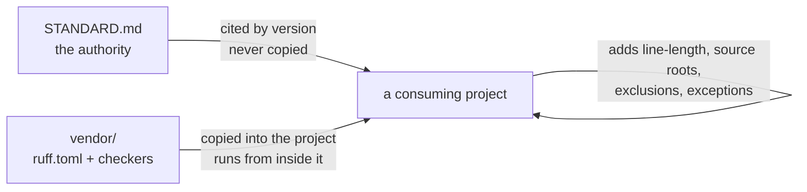

# Engineering conventions

A small, durable engineering standard for Python projects, and the minimum
tooling that makes it checkable.

[](https://github.com/olegturzhanskii/engineering-conventions/actions/workflows/ci.yml)
[](CHANGELOG.md)
[](LICENSE)

It is built to travel.

Nothing in it names a project, a domain, a company, or a machine.

## Where it began

The standard grew out of working on one codebase with language models.

A model given a problem in the code would reason about it and write the code
that solved it, and when a problem of the same kind came back it reasoned
again from the beginning and solved it with a different mechanism.

Each solution could be sound on its own; what went missing lay between them,
since the reasoning behind the first and the mechanism that carried it out had
been kept in no form a second attempt would start from or defer to.

Every repetition paid again, in effort, in time, and in tokens, for work that
could have been reused, and the solutions differed in ways nobody had decided.

The small decisions behaved the same way: how a signature is laid out, what a
comment is for, which spelling a document uses, and what an import looks like
were settled in one session and reopened in the next, so files drifted apart
on questions that had already been argued once.

The response was to stop depending on anyone, person or model, to remember or
reconstruct those decisions: write each one down with the reason for it, give
a tool the part of it a tool can decide, and hold every change to the result.

The aim was never to reason less; it was to stop reconstructing decisions
whose results could have been kept.

When the same rules were needed in more than one project, they left the
project they began in and became this repository: a standard with a version,
so a project can say which one it follows, and the checks beside it, so a
project can show that it does.

One rule shows the whole path: American English began as a decision record in
one project, with a note that a spelling check would raise too many false
alarms to automate, and it is now §7 of the standard with a candidate check,
whose output is a list of suspects for a person to judge rather than a proof.

## What it does about it

`STANDARD.md` records each convention with the reasoning behind it, so a rule
can be applied to a case its examples never showed and questioned when its
reason stops holding, and every rule says whether it is a requirement, a
default, or a matter of judgment, and how far a machine can check it.

Python leaves many such choices open on purpose: a parameter may be
positional-only, keyword-only, or either, and each form has its use.

A project with a sound reason to settle that choice for a whole category of
callables gains nothing from reopening it at every definition, so §13 settles
it for the callables a project owns, says why, and the checker holds it.

`vendor/tools/check_conventions.py` decides the properties a tool can decide and
reports what it can only suspect as a candidate for a person to judge, because
a tool whose findings include guesses is soon read less carefully.

The gate runs the checker's self-test before the scan, so that a clean result
is evidence about the code and not about a check that quietly stopped reaching
anything.

| Piece | What it does |
| --- | --- |
| A convention | Preserves a decision so it is not made again |
| Its reasoning | Says what the decision is for, so it applies to a case the examples do not cover |
| The standard | Holds the conventions as one versioned authority every participant answers to |
| The checker | Verifies the properties a tool can decide, and reports what it can only suspect |
| The gate | Runs the positive control and then the checks, so that a clean result is evidence |
| Review | Judges correctness and design, which no check reaches |
| The version | Makes a change to the authority deliberate and traceable |

A passing run establishes that the properties the checks cover hold, and no
more: whether the change is correct, whether its design is sound, and whether
it should exist at all stay with review.

## One standard for people and models

A person and a model change the same codebase by different routes, and the
codebase has one set of expectations, so the standard states them once, for
the material, and the gate holds every change to them whoever drafted it.

Both kinds of change therefore meet at the same place: the same rules, read
with the same reasoning, checked by the same tool, and then reviewed.

A participant-specific instruction file serves a different purpose, guiding
how one participant works, and it can point that participant here; the
standard is where the shared expectations live, and the checker is what
verifies the properties it can.

Checks and contracts were worth having before a model wrote a line of code;
what has changed is the share of the work they protect.

When a draft costs little, changes arrive faster than understanding of them
grows, and the work that does not get cheaper, understanding a change, fitting
it into the system, and reviewing it, becomes the narrow point.

A model works from the context it is given, and where that context is
incomplete or misread it can fill the gap with an assumption that is plausible
and wrong, which is hardest to notice for a reviewer who is reconstructing the
same context.

A rule a tool checks, a reason written beside it, and a check that fails on
the violation it specifies each reduce the places where correctness rests on
reconstruction alone, including a violation its author, person or model,
believed was conformant.

The larger problem is comprehension debt: the gap between a system as it is
and what the people working on it can explain of its structure, its
constraints, how its parts interact, and what a change will do to it.

Explicit conventions and checks take some of that burden off every change, and
nothing here claims they take all of it.

## The principle behind it

The standard is the smallest instance of a general idea: a decision made
explicit, kept, and checked where it can be does not have to be made again at
the next change.

Architecture does the same at a larger scale: a port is an explicit contract,
and an adapter behind it has one thing to satisfy, so whoever writes the
adapter starts from the contract rather than from the whole system, and
whoever reviews it reads one boundary rather than all of them.

Types and interface contracts do it at the scale of a call, and conventions
with their checks at the scale of a line; the levels are neither
interchangeable nor all needed by every project, and what they share is that
each decides something once and makes the decision visible.

`docs/rationale.md` follows the idea further: how comprehension debt accumulates
and what explicit structure does about it, what a model gets from such
structure, how a settled boundary lets work be divided, and when cheaper
drafting makes such structure a better investment and when it does not.

## How it travels

**The standard is referenced by version; the enforcement is copied.**



A copied authority drifts: six months later two projects hold two texts, both
called the standard, differing in ways nobody decided.

Citing a version instead lets a reviewer answer the only question that
matters — is this difference a violation, or a version gap?

Enforcement is the reverse.

A project's gate must not depend on a path outside the project, its reviewers
must see the rules in its own diff, and its checks must keep working when this
repository is not reachable.

## What is here

```text
engineering-conventions/
├── STANDARD.md          the authority — cite this by version, do not copy it
├── CHANGELOG.md         versions, so a project can say which one it follows
├── LICENSE              Apache-2.0
├── NOTICE               a copyright line, kept where §4(d) carries it forward
├── pyproject.toml       this repository's own configuration
├── .taplo.toml          its TOML formatting, copied from vendor/taplo/
├── Makefile             this repository's own gate
├── docs/
│   ├── rationale.md     the idea behind the standard, followed past this page
│   ├── adoption.md      how a project adopts it: minimal path and full path
│   ├── versioning.md    what the version means, and what a change costs
│   └── workflow.md      how to audit an existing codebase against it, once
├── vendor/              the only directory a project copies
│   ├── ruff/            linter and formatter configuration templates
│   ├── taplo/           TOML formatter configuration template
│   └── tools/           the two checkers, standard library only
└── sandbox/             a complete tiny project that has adopted the standard
```

## Checking a project without copying anything

The same checker audits a project from outside it.

```sh
python3 vendor/tools/check_conventions.py --project /path/to/project src tests
```

It reads that project's `[tool.check-conventions]` table, resolves paths there,
and prints the standard version alongside the findings.

The result is identical to running the vendored copy from inside the project,
which is the property that makes the two interchangeable rather than two
different checks.

## The sandbox

`sandbox/` is a working miniature project, not a code listing.

It has its own `pyproject.toml`, its own `Makefile`, a vendored copy of the
checker under `tools/`, and a `counterexamples/` directory that its gate
deliberately excludes.

Reading it answers the questions the prose cannot: where project-local
settings go, what a recorded exception looks like, and what the checker prints
when it finds something.

```sh
cd sandbox && make verify
```

```sh
cd sandbox && make demo-violation
```

The second command points the checker at the counterexamples the gate skips.

It is a demonstration and a positive control at the same time.

## Where the rules come from

Two external authorities, narrowed but never contradicted:

- **Commit messages** — the Conventional Commits convention at
  <https://gist.github.com/qoomon/5dfcdf8eec66a051ecd85625518cfd13>
- **Comment markers** — the vocabulary of
  <https://github.com/folke/todo-comments.nvim>

`STANDARD.md` §1 sets out the precedence between those, this standard, a
project's own decisions, and the semantics of the language and its libraries.

## Who it is for

A codebase that more than one participant changes, whether the participants
are people, models, or both, because one stated standard replaces the separate
assumptions each would otherwise bring about how the code should be written.

A person who keeps more than one Python project to the same rules and does not
want the rules to drift between them.

A reviewer who needs to tell a violation from a decision from a version gap
without asking anyone, and who wants the checkable part of a review done
before the reading starts.

## Adopting it

**Minimal**, for a project that wants the rules enforced and nothing else:

1. Copy `vendor/ruff/ruff.toml` to the project root.
2. Add the project's own `line-length` and `src` to it.
3. Run `ruff check` and `ruff format --check` in the project's gate.

**Full**, adding the rules no formatter can express:

4. Copy `vendor/tools/check_conventions.py` into the project's tooling
   directory, and record the commit it came from.
5. Add it to the gate, with `--self-test` running first.
6. Cite the standard's version in the project's contributor documentation.

`docs/adoption.md` has the detail: which files are reference material and never
copied, how to layer project configuration without editing the vendored files,
and how to record a project-specific exception.

## Reading it for the first time

`STANDARD.md` runs to about ten thousand words, so reading it top to bottom
takes the better part of an hour.

Section 2 is the one to read even if nothing else is: it is about when a rule
is allowed to exist at all, and its absence is the most expensive gap a
codebase can have.

## This repository follows its own standard

```sh
make setup && make verify
```

`make setup` creates the environment from `uv.lock`, and every tool in the gate
runs inside it.

A bare `ruff` or `pytest` would resolve to whatever the shell happened to offer,
which is how a run reports green against versions the manifest does not
accept.

That runs the formatter check, the linter, the type checker, the conventions
checker against this repository's own Python, Markdown, and Makefiles, a drift
check that the vendored copies still match what `vendor/` publishes, a proof
that every counterexample is still caught, and the sandbox tests.

The one exception is `sandbox/counterexamples/`, which breaks the rules on
purpose.

`STANDARD.md` §1 explains why that is legitimate and how such material must be
marked.

Continuous integration runs the same gate on every push to `main` and every pull
request, on the lowest Python `requires-python` allows and on the newest.

## Where it is used

[Wordwinnow](https://github.com/wordbench/wordwinnow) is a public project that follows the standard the way this page
describes: it cites a version, vendors the checker, and runs it in its gate
after the self-test, so an adoption can be read there in full.

The environment the standard is applied from, the editor, shell, terminal, and
Git configuration, is public in [dotfiles](https://github.com/olegturzhanskii/dotfiles); the two repositories are
independent of each other, and adopting the standard needs nothing from that
environment.

## Who made it, and how

Generative AI did a substantial part of the engineering work on this
repository, through models of two families: Claude, by [Anthropic](https://www.anthropic.com), and GPT,
by [OpenAI](https://openai.com).

Claude models worked in the repository: they drafted much of the standard's
text, the checker with its self-test controls, the sandbox, and the
documentation, and reviewed and refined that work.

GPT models worked with me on the reasoning behind it: they helped me assess
the state of the work, formulate and organize the positions the standard takes
and the reasons for them, find omissions and inconsistencies, and question
assumptions and formulations.

The positions are mine, and so is the responsibility for them: which rules
exist, which are requirements and which defaults, how far a tool checks each,
and what each version changes were my decisions, whichever of us first
proposed the wording.

My changes and the models' changes are judged against the same standard,
regardless of who drafted them.

## License

Apache-2.0.

The `NOTICE` file is a choice rather than a requirement: the license asks that
copyright and attribution notices be preserved, and its §4(d) applies only
once a project has a `NOTICE` file for a derivative to carry forward.

Keeping one is how the copyright line reaches anyone who builds on this.

The license was chosen over a shorter permissive one for §4(b): a modified
file must say that it was modified, so a changed standard cannot circulate as
this one.
